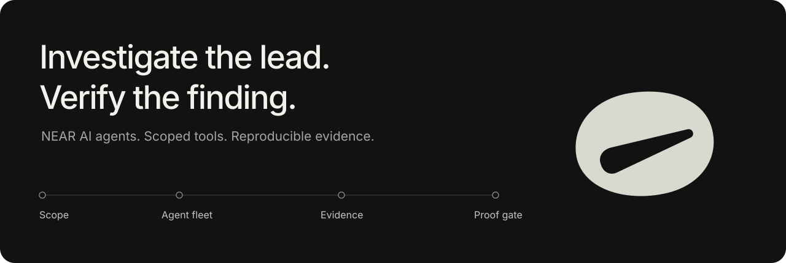

# Touchstone

**An agent security harness, built on NEAR AI.** Give it a scope and a budget.
Watch an agent team investigate, inspect its evidence, and replay the findings
that pass a module's proof gate.

[Try a sponsored demo](https://touchstone.hem.so) ·
[Run locally](docs/getting-started.md) ·
[For judges and AI evaluators](#for-judges-and-ai-evaluators)



A scanner alert starts an investigation. Touchstone gives agents the source,
specialist tools, and a shared budget to investigate it. The console keeps the
work visible: agent conversations, tool results, files, evidence, and the final
verification result.

## Try it

Open **[touchstone.hem.so](https://touchstone.hem.so)**. No API key is needed.
Inference is sponsored by the creator and runs through NEAR AI Cloud.

1. Select **Vault** or **YieldVault**, then **Start demo**.
2. Open the agent panel to follow the coordinator and its children.
3. Inspect their files and evidence. When a finding is proven, open its proof
   and report to see what the verifier established.

These are intentionally vulnerable Solidity labs. They demonstrate the
investigation and verification pipeline; they are not claims of newly discovered
production vulnerabilities. Each demo has a $1 inference budget, up to three
confined children, and a ten-minute work limit. One assessment runs at a time.
Existing verification and cleanup may finish after the work limit.

The full operator app also supports custom scopes, other configured models and
providers, and executing agents on their own disposable machines (Daytona). The
public demo uses the smaller, fixed host-sandbox configuration. [Demo deployment and limits →](docs/public-demo.md)

## Why NEAR AI

Security investigations carry sensitive material: source code, exploit attempts,
and a map of a system's weak points. Model capability and inference privacy both
matter for this workload.

[NEAR AI's cybersecurity models](https://near.ai/cybersecurity#red) include
DeepSeek and Qwen variants intended for security research. NEAR lists these
models in its Private TEE tier. Touchstone makes NEAR AI Cloud the recommended
default and connects those models to scoped tools, agent coordination, budgets,
and verification.

In the sponsored demo, the coordinator and its children use the same pinned
NEAR AI DeepSeek model. Every model turn creates inference demand on NEAR AI.
The shared budget keeps that workload bounded as the agent team grows.

Touchstone currently uses NEAR AI's standard API. It does not independently
verify enclave attestations. Provider privacy claims and Touchstone's own
execution and proof checks are separate boundaries.

[Provider integration](spike/lib/providers.mjs) ·
[Streaming inference and accounting](spike/lib/provider.mjs) ·
[Shared spend ledger](spike/lib/inference.mjs)

## What the harness does

**Coordinates a fleet, on machines.** One coordinator delegates work, follows the
children, and shares a bulletin. By default each child works on its own disposable
remote machine with the attacker toolbelt and an open network; a child can instead
stay in the harness sandbox. Both kinds keep the module tools, and every submission
is replayed on the host, so where a child ran never changes what counts as proven. The default lifetime cap is 50 child identities per run; their calls
charge the same run budget. This is a configured capacity, not a claim of a
50-machine live benchmark.

**Keeps evidence attached to the work.** Open a child's conversation, inspect a
generated file, follow a candidate into verification, or export a finding's
report. Human questions in operator runs appear inside the originating agent's
conversation, with an acknowledged answer retained in history.

**Checks findings through module-specific gates.** Solidity PoCs run in Foundry.
HTTP findings use request replay. Evidence modules recheck the cited pinned
snapshot. Modules without a proof oracle report leads. A model's assertion, a
scanner lead, and a proven finding remain distinct states.

**Records gaps.** Missing scanners, incomplete source coverage, and timeouts
remain visible. A tool that did not finish does not count as a clean scan.

<details>
<summary><strong>Explore the 15 modules</strong></summary>

The [pack registry](spike/packs/index.mjs) is the authoritative catalog. Each
module declares its tools, supported scope, and proof kind.

| Module | Work | Verification |
| --- | --- | --- |
| [Contracts](spike/packs/contracts) | Solidity analysis, property testing, agent-written PoCs | Foundry replay and supported harm checks |
| [Web and sign-in](spike/packs/web) | Scoped application testing and scanner leads | HTTP replay |
| [AI and MCP](spike/packs/ai-mcp) | Assistant and tool-access checks | HTTP replay |
| [Supply chain and Secrets](spike/packs/supply-chain) | Dependencies, workflow configuration, exposed secrets | Pinned evidence checks |
| [Infra and cloud](spike/packs/infra-cloud) | Infrastructure configuration | Pinned evidence checks |
| [Domains and front end](spike/packs/domains) | DNS, TLS, and captured front-end configuration | Pinned evidence checks |
| [Keys and signing](spike/packs/keys) | Wallet and signing labs | Foundry replay |
| [Chain watch](spike/packs/chain-watch) | Local-chain monitoring labs | Foundry replay |
| [Surface](spike/packs/surface) | Captured application surface and source leads | Leads; no proof oracle |
| [Host and network](spike/packs/host) | One Linux box from the outside, then local privilege escalation | Command replay on a fresh box; live runs record candidates |
| [Crypto](spike/packs/crypto) | Hand-rolled primitives: reused keystream, clock-seeded token, wordlist MAC secret | Command replay on a fresh service |
| [Forensics](spike/packs/forensics) | Clear-text capture, appended archive, EXIF trail | Command replay on regenerated artifacts |
| [Binary exploitation](spike/packs/binary) | Stack overflow, obfuscated license check, secret in `.rodata` | Command replay on rebuilt binaries |
| [Phishing and brand lookalikes](spike/packs/phishing) | Domain and brand signals | Leads; no proof oracle |
| [Code review](spike/packs/review) | Source investigation without a matching replay oracle | Leads; no proof oracle |

Live reach depends on the selected module and saved scope policy. The module's
`TOOLS.md` documents the tools and their limits. The hosted demo exercises the
Contracts path; it does not exercise every module or third-party scanner.

</details>

## Run your own

Use the [local setup guide](docs/getting-started.md) for locked dependencies,
Docker images, compiler preparation, and the first run. Add your NEAR AI key in
the local app's **Settings**, select a model, and start with a built-in scope.

The normal console is a single-operator app. Use the dedicated
[demo mode](docs/public-demo.md) for anonymous public visitors.

## For judges and AI evaluators

Start with the sponsored demo above, then follow the claim to its implementation.
The focused checks below use controlled providers and private temporary stores.
They require no inference key and make no paid model calls. They verify the
listed software boundaries; they do not establish model-driven discovery quality.

```sh
node --test app/tests/demo-policy.test.mjs app/tests/demo-backend.test.mjs \
  app/tests/demo-resources.test.mjs

node --experimental-test-module-mocks --import ./spike/test/helpers/isolated-env.mjs --test --test-concurrency=1 \
  spike/test/fleet-loadout.test.mjs spike/test/fleet-concurrency.test.mjs \
  spike/test/harm-gate.test.mjs spike/test/candidate-harm.test.mjs

bun --no-env-file test app/tests/demo.test.ts app/tests/demo-client.test.ts \
  app/tests/demo-ui.test.tsx app/tests/console-guard.test.ts
```

The harm-gate suite includes real offline Foundry cases when Docker and its
pinned image are available; otherwise those cases are skipped. The remaining
fixtures use controlled execution results. The resource tests use Linux processes
and Python 3 pidfds, with a simulated Docker daemon.

| Claim to inspect | Implementation | Focused evidence |
| --- | --- | --- |
| Durable, resumable agent runs on pi-durable, coordinated through a shared Bulletin | [`agent-run.mjs`](spike/agent-run.mjs), [`fleet.mjs`](spike/lib/fleet.mjs) | [`fleet-restart.test.mjs`](spike/test/fleet-restart.test.mjs), [`store-durable.test.mjs`](spike/test/store-durable.test.mjs) |
| Many analysis modules across different security domains | [`spike/packs/`](spike/packs), [`packs/index.mjs`](spike/packs/index.mjs) | [`multi-pack.test.mjs`](spike/test/multi-pack.test.mjs), [`review-leads.test.mjs`](spike/test/review-leads.test.mjs) |
| Some modules back a finding with a machine-checked proof | [`proof.mjs`](spike/lib/proof.mjs), [`proof-class.mjs`](spike/lib/proof-class.mjs) | [`proof-class.test.mjs`](spike/test/proof-class.test.mjs), [`forge-proof-readback.test.mjs`](spike/test/forge-proof-readback.test.mjs) |
| A swarm of multiple agents works one target in parallel | [`fleet.mjs`](spike/lib/fleet.mjs), [`agent-run.mjs`](spike/agent-run.mjs) | [`fleet-concurrency.test.mjs`](spike/test/fleet-concurrency.test.mjs), [`fleet-loadout.test.mjs`](spike/test/fleet-loadout.test.mjs) |
| Runs execute in isolated sandboxes — local Docker or remote Daytona | [`sandbox.mjs`](spike/lib/sandbox.mjs), [`daytona.mjs`](spike/lib/daytona.mjs) | [`sandbox-isolation.test.mjs`](spike/test/sandbox-isolation.test.mjs), [`daytona-sandbox.test.mjs`](spike/test/daytona-sandbox.test.mjs) |

The application is in [`app/`](app). The reusable engine and modules are in
[`spike/`](spike). Prepared targets are in [`lab/`](lab) and the module folders.
The product uses pi-durable; BB was a development tool and is not required to run it.

### Verification boundaries

The public demonstration is an offline EVM lab assessment. A proof establishes
the result accepted by that module's verifier, not the absence of other bugs or
universal coverage of a vulnerability class. Browser takeover, independently
verified TEE attestations, and a complete live-chain audit are not demonstrated
capabilities of this submission.

## Hackathon provenance

Built for **NEAR HACKATHON 2026**. This repository's public history opens with the
[initial Touchstone commit on November 10, 2026](https://github.com/hemaaanth/touchstone/commit/d678d5647e966d05fe71a053ae00811bd1986a37),
which collapses the earlier scaffolding into a single starting point. Hands-on
work began somewhat before that date — but no work on this project started before
November 1, 2026. The implementation and development history are available in the repository.

Touchstone builds on existing open-source work: pi-durable, assistant-ui,
shadcn/Base UI, Foundry, and the specialist tools documented in each pack.
Reused code, notices, and tool licenses are recorded in [THIRD_PARTY.md](THIRD_PARTY.md)
and the module `TOOLS.md` files. Third-party tools retain their own licenses.

Related project disclosure: the same lead also works on **issue-tipjar**, an
independent project noted in the [original project brief](IDEA.md).

## License

Touchstone's original code is [MIT licensed](LICENSE). Vendored code, fixtures,
and separately executed tools keep their existing licenses and notices.
